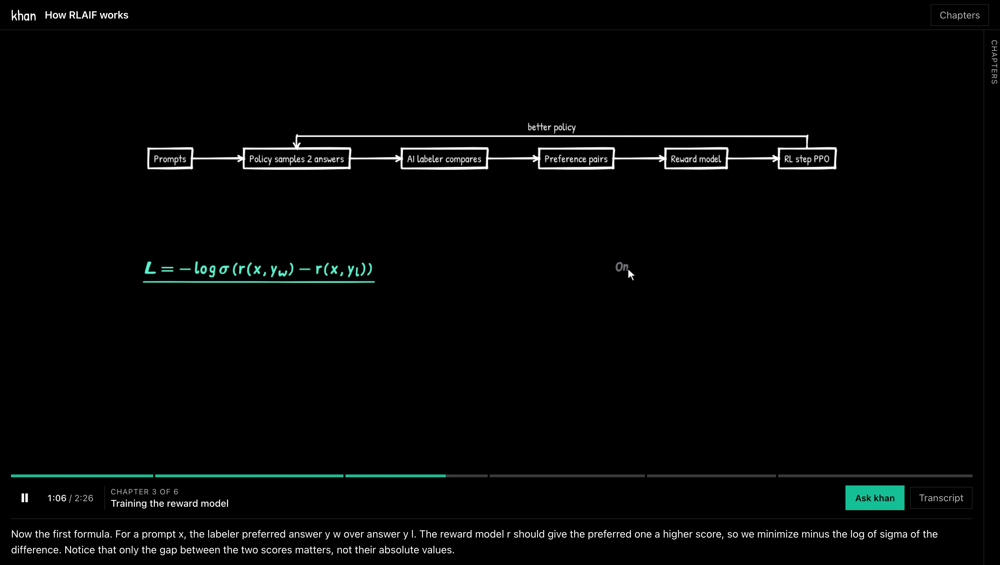
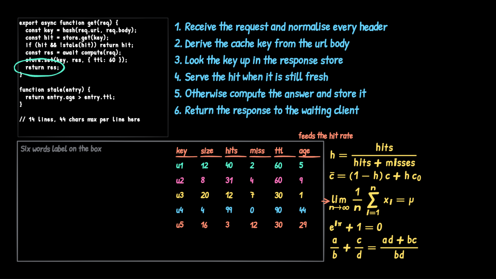
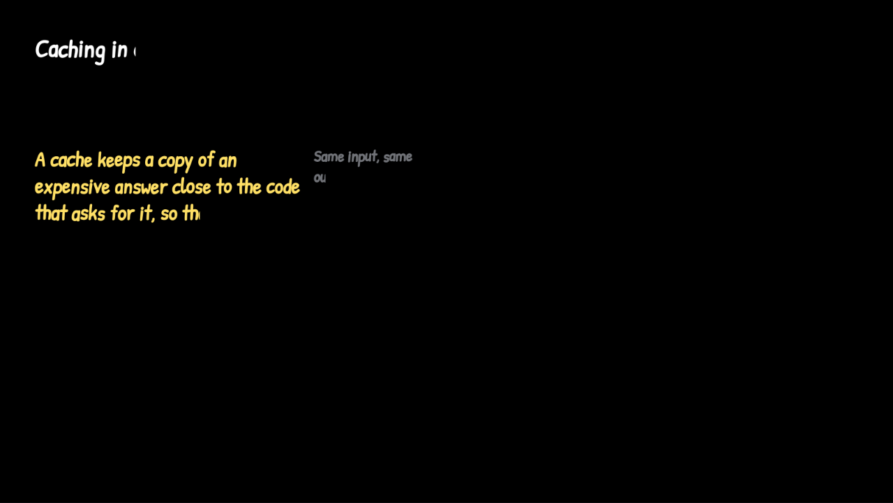
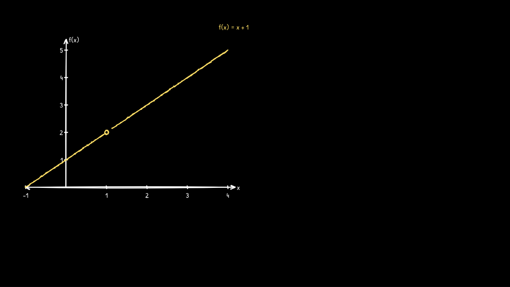
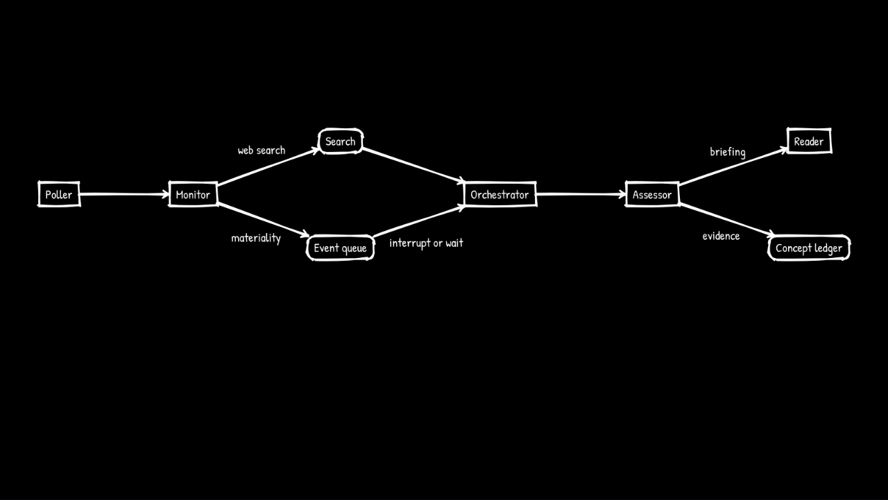
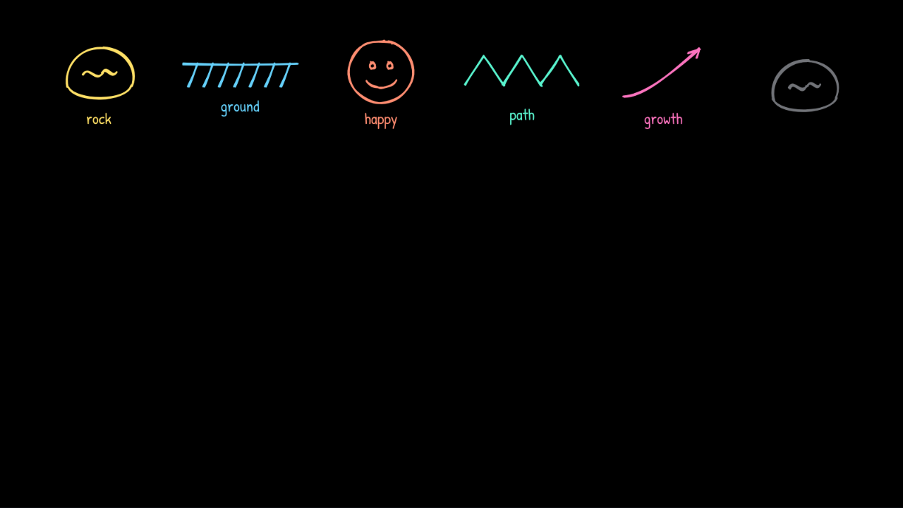

# khan

khan turns your Claude Code responses into a Khan Academy style video. Just type `/khan` and ask your question to create the video.



## Try it in five minutes

You need Node 20 or newer, Claude Code, and an OpenAI API key (used only for the voice).

```bash
git clone https://github.com/sanjivp2703/khan-whiteboard-agent.git
cd khan-whiteboard-agent
npm install
./scripts/install-skill.sh        # installs /khan as a personal Claude Code skill, usable from any folder
export OPENAI_API_KEY=sk-...      # in the shell you launch Claude Code from
claude                            # open Claude Code anywhere
```

Then, inside Claude Code, ask about anything and turn the answer into a lesson:

```
> /khan explain how RLAIF works to me
```

A browser tab opens, the chapters appear in the sidebar, and the first narrated chapter starts within a few seconds while the rest are still being written. If Claude has just answered something, `/khan explain that to me` turns that answer into the lesson. Free text shapes it:

```
/khan explain just the reward model part to me, for a junior, short
/khan teach me the second algorithm like Khan Academy, about two minutes
```

Natural phrasing works too: "khan, explain this", "whiteboard this", "draw this out for me", "turn this into a lesson".

## How it works

khan is three parts that never talk to each other directly. One folder on disk is the whole contract between them.

1. **The producer is Claude, inside your Claude Code session.** The skill tells it to write an outline (the chapter list you see immediately), then one scene at a time as a small JSON file: a title, 15 to 90 words of narration, and a short list of things to put on a six-by-four grid of board cells. Claude never touches audio or pixels. After each scene it blocks on `khan wait`, which is how your questions reach it.
2. **The server watches the folder.** For each scene it validates the shape and the layout (nothing overlaps, nothing spills out of its cell, every arrow points at something), sends the narration to the voice service and measures the audio, then streams the ready scene to the player. A scene that fails validation goes back to Claude for one rewrite; if it fails again the server keeps the narration, drops the bad element, and plays on. A lesson never stalls on a layout mistake.
3. **The player draws.** Each element appears as pen strokes at a fraction of the scene's audio, so the voice is the only clock and drawing can never drift from narration. Playback starts as soon as scene one has audio. If the voice finishes before the last stroke, the player holds a short silence rather than cutting the pen off. If the next scene is not ready, the pen idles and a caption says khan is thinking.

Because the producer only writes files, it could later be swapped for a program that streams the script from the API without the server or player noticing. In practice Claude writes each scene faster than the previous one plays, so that has not been needed.

**Twelve things can go on the board.** Text, lists, code, tables, math (LaTeX), boxes, arrows, highlights (circle, underline, wavy, double, box, strike, or a resting pointer), sketches from a library of fifteen doodles, flowchart diagrams (Mermaid syntax, laid out so nothing overlaps), plots (functions or points, with axes, ticks, labels, and an open circle for a hole), and small SVGs as a last resort. The skill tells Claude which to reach for first: sketch, then diagram, then plot, then SVG.

## How it was made to look and sound like Khan Academy

No model was trained. Everything Khan-like comes from two rounds of research against the real thing, turned into renderer rules, timing rules, and instructions to Claude, then checked with tests and by eye.

### Round one: the look and the voice

The first version used placeholder colors and a chalk-stick cursor. Khan Academy publishes a help article for people who recreate their videos, with an official palette and creator guidelines. From that, plus frames of Sal Khan's own videos:

- **Board** pure black, as the guidelines say to flood-fill.
- **Colors** Khan Academy's official on-black palette: white, yellow `#FFE066`, light blue `#65D0FA`, coral `#FF8D71`, teal `#59F3CE`, pink `#FB73BE`, grey `#717378` for axes and notes. Their rule, kept here: never true red on black. Every new idea gets its own color and keeps it for the whole lesson.
- **Cursor** a plain white arrow pointer, which is what his videos actually show, not a pen icon.
- **Voice** cloning Sal's voice was off the table. Six stock voices were synthesized on the same paragraph and measured for pitch and pace; `ash` came closest to a mid-range male voice with the slowest, most pausing delivery. The speech model is given a delivery description derived from Khan Academy's creator guidance: warm, unhurried, thinking out loud, like explaining to a cousin at the kitchen table.

### Round two: watching the videos

Six Sal-narrated videos across subjects (limits, basic addition, the chain rule, photosynthesis, law of demand, Newton's first law) were sampled frame by frame, with one-second bursts to see motion. What the study found, and what changed because of it:

| Sal, with timestamps | khan before | khan now |
|---|---|---|
| 30 to 50 percent of a video has no new ink; he hovers the cursor over what he is discussing (limits 0:28 to 0:46, 18 seconds pointing at a numerator) | pen stretched every element across its whole window, never pointed | writes at hand speed, then parks and hovers on the element; the pen travels to the next element with a short tween |
| First stroke after 3 to 60 seconds of talking, median 15 | first element at time zero | first element starts about 8 percent into the narration |
| A five-letter word in 1.5 to 5 seconds, an equation line in 8 to 15 | 1500 board pixels per second | 550 pixels per second, with word and line pauses |
| Quick slanted print, cap height 45 to 50 pixels on this board scale | upright, 40 percent smaller | 38 pixel body text with a 6 degree slant and small per-letter jitter |
| Letters appear as single strokes | outline traced, then filled | left-to-right sweep reveal |
| Equations handwritten | typeset by MathJax | MathJax does the layout, the handwriting font draws the glyphs, bars and radicals stay as strokes |
| Tables with no grid: underlined headers, a color per row | grid lines | gridless, color per row |
| Axes as two strokes with arrowheads, integer ticks written one at a time, names at the ends, dots with letter labels, an open circle for a hole | min and max labels only | all of it |
| Crude 60 to 120 pixel doodles with a one-word label | shapes filled their cell | doodle scale, centered, label beside |

After the slower pen landed, dense scenes could no longer be written inside their narration, so long elements now get proportionally longer windows, the last element is never allowed to pop in after the voice ends, and the skill carries a pacing budget: about one written word per two spoken, and a code block of n lines needs roughly 2n plus 4 seconds of narration or its own scene.

Each round was verified the same way: a fixture sweep of 23 lessons and 90 scenes through the validator and both renderers with zero elements outside their cell, a browser test suite of 66 scenarios including questions nested three deep, and a real lesson watched in Chrome. The research files with sources and timestamps are in `design/`, and every QA report is in `qa/`.



|  |  |
|---|---|
| Letters appear left to right; ink only exists behind the pen. | Hand-drawn axes, integer ticks, and an open circle at the hole. |
|  |  |
| Flowcharts are laid out so labels never cross arrows or nodes. | Doodles at Sal's scale: rock, ground, smiley, zigzag, curve. |

## Every way to ask

| Command | Meaning |
|---|---|
| `/khan` | explain the whole of Claude's last response |
| `/khan <focus>` | explain part of it: `/khan just the caching part` |
| `/khan ... for a junior`, `... for a product manager` | audience hint |
| `/khan ... short`, `... about two minutes`, `... thorough` | length hint: roughly 3 to 5, 5 to 8, or 8 to 12 chapters |

Claude keeps its turn open while the lesson plays so it can answer your questions. It ends the turn when the lesson finishes or the tab closes, and prints a one-line summary with the lesson id.

## Appendix

### The command line

All commands print one line of JSON; add `--pretty` to read it.

| Command | What it does |
|---|---|
| `./bin/khan serve [--port N]` | start the local server if not running, print its state and whether the voice is ready |
| `./bin/khan play <lessonId> [--no-open]` | replay a finished lesson, starting the server if needed |
| `./bin/khan status <lessonId>` | chapters planned and ready, questions answered, where the player is |
| `./bin/khan outline -` and `./bin/khan scene <lessonId> <sceneId>` | used by the skill to write the lesson; read JSON on stdin |
| `./bin/khan wait <lessonId> --timeout 100` | used by the skill; blocks until a question, a rejection, or the end |

### Settings

| Variable | Purpose |
|---|---|
| `OPENAI_API_KEY` | required for the voice; exported in the shell the server starts from |
| `KHAN_HOME` | where lessons, audio cache, and the server pidfile live; default `<repo>/.khan` |
| `KHAN_PORT` | server port; default 7777 |
| `KHAN_NO_OPEN=1` | do not open a browser tab |

A lesson costs a few cents of speech synthesis; everything else runs locally.

### Running the tests

```bash
npm test            # unit tests, about 20 seconds
npm run test:e2e    # browser tests with Playwright, about 3 minutes
npm run check       # syntax check of every file
```

All tests run offline with a silent voice provider; no key is needed.

### Where things are

| Path | What |
|---|---|
| `.claude/skills/khan/SKILL.md` | the instructions Claude follows as producer, with a cheat-sheet of every element and cap |
| `server/` | folder watcher, validator, voice provider, HTTP and event stream |
| `player/` | the browser player: engine, renderers, chrome |
| `shared/` | the scene schema, layout grid, handwriting, math, and parsers shared by validator and renderer |
| `spec.md` | the living spec; every change merges its deltas here |
| `design/` | the Khan Academy research: palette and voice study, the video study, the player UI study |
| `qa/` | every QA report |
| `docs/DEVELOPMENT.md` | the developer reference: contracts, API, fixtures, ownership |
| `changes/`, `backlog.md`, `checkpoints.md` | how work is proposed, tracked, and decided |

Built with Claude Code as a multi-agent pipeline: research, spec, parallel builders in git worktrees, QA, fixers, and retro, with a human approving the spec, the design, and each release.
